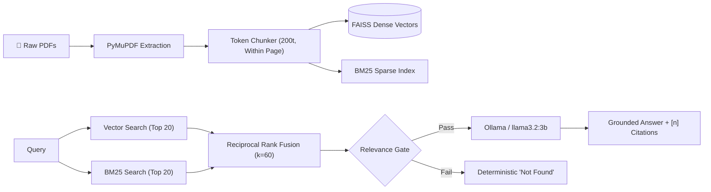

<div align="center">

# Saksham Kriplani
### **Applied AI & Full-Stack Systems Engineer**

*Designing grounded document intelligence engines, hybrid retrieval architectures, and type-safe distributed web applications.*

<br/>

[](https://enterprise-ai-knowledge-engine.vercel.app)
[](https://linkedin.com/in/SakshamKriplani)
[](mailto:kriplanisaksham.31@gmail.com)
[](https://github.com/SakshamKriplani)

</div>

---

## 📌 Executive Summary

I am a software engineer focused on bridging the gap between cutting-edge AI models and production software engineering. My work focuses on **auditable Retrieval-Augmented Generation (RAG)**, **hybrid vector-lexical search algorithms**, and **modular backend/frontend architectures**.

Rather than relying on ungrounded generative black boxes, I design deterministic information retrieval pipelines that enforce page-level auditability, sub-second latency, and zero hallucination tolerances.

---

## 🏗️ Core Engineering Specializations

```text
┌──────────────────────────────────────────────────────────────────────────────┐
│  AI & Grounded Retrieval (RAG)                                               │
│  Dense Vector Search (FAISS) • BM25 Lexical Scoring • Reciprocal Rank Fusion │
│  Sentence Transformers • Page-Bounded Chunking • Deterministic Relevance Gate│
├──────────────────────────────────────────────────────────────────────────────┤
│  Backend Systems & Data Architecture                                         │
│  FastAPI • Python 3.11+ • Pydantic v2 • Async Architecture • SQLite • REST   │
├──────────────────────────────────────────────────────────────────────────────┤
│  Modern Frontend Engineering                                                 │
│  React 18 • TypeScript (Strict) • Tailwind CSS 4 • Vite • Recharts • SPA     │
├──────────────────────────────────────────────────────────────────────────────┤
│  DevOps & Platform Engineering                                               │
│  Docker Containerization • Vercel Edge • Linux • CI/CD Pipelines • Git Ops   │
└──────────────────────────────────────────────────────────────────────────────┘
```

---

## 🚀 Flagship Project: Enterprise AI Knowledge Engine

> **Production-grade grounded document intelligence platform with hybrid retrieval, page-level citations, and local LLM reasoning.**  
> 🔗 **Repository:** [github.com/SakshamKriplani/Enterprise-AI-Knowledge-Engine](https://github.com/SakshamKriplani/Enterprise-AI-Knowledge-Engine)  
> 🌐 **Interactive Live Application:** [enterprise-ai-knowledge-engine.vercel.app](https://enterprise-ai-knowledge-engine.vercel.app)



### Architectural & Engineering Highlights:
- **Token-Aware Page-Bounded Chunking:** Chunks are strictly constrained within individual PDF pages and tokenized via `sentence-transformers/all-MiniLM-L6-v2` tokenizer offsets (200 tokens window, 40 overlap), guaranteeing 100% exact page-level citations.
- **Reciprocal Rank Fusion (RRF):** Fuses dense embeddings and BM25 lexical scores ($k=60$) to eliminate scale mismatches between cosine similarity and BM25 scores.
- **Deterministic Hallucination Gate:** An empirical cosine threshold ($0.25$) halts pipeline execution on out-of-domain queries, bypassing generative hallucination.
- **Real Benchmark Performance:**
  - **Hybrid Hit@1:** `86.7%` (vs. Semantic `80.0%`, Keyword `73.3%`)
  - **Hybrid Hit@5:** `96.7%` | **MRR:** `0.897`
- **In-Browser Demo Engine:** The entire retrieval lifecycle (BM25 tokenization, RRF fusion, candidate deduplication, and citation parsing) was ported to client-side TypeScript to run in the browser at zero operational cost.

---

## 🛠️ Comprehensive Technical Stack

### Languages & Runtime


### AI, Information Retrieval & NLP


### Backend Engineering


### Frontend Engineering


### Tooling & Infrastructure


---

## 📐 Engineering Principles & Practices

1. **Deterministic Grounding Over Blind Trust:** AI outputs must be bounded by structured source passages. Every generated claim must link directly to an auditable document and page number.
2. **Strict Type Contracts:** End-to-end type safety using Python Pydantic v2 schemas for all backend I/O and strict TypeScript with zero `any` on the frontend.
3. **Data-Driven Architecture:** Algorithms and configurations (such as chunk size, overlap, embedding models, and RRF parameters) are selected through empirical benchmarking (`run_eval.py`), not intuition.
4. **Resilient Failure Modes:** Explicit HTTP status contracts, clean error boundaries, and graceful degradation paths when upstream AI components or network dependencies are unreachable.

---

## 📊 Analytics & Activity

<div align="center">
  
  
</div>

<br/>

<div align="center">
  
</div>

---

## 📬 Let's Connect

I am always open to discussing distributed systems, RAG architectures, applied machine learning, or software engineering opportunities.

- 💼 **LinkedIn:** [linkedin.com/in/SakshamKriplani](https://linkedin.com/in/SakshamKriplani)
- 📧 **Direct Inquiries:** [kriplanisaksham.31@gmail.com](mailto:kriplanisaksham.31@gmail.com)
- 🌐 **Project Showcase:** [enterprise-ai-knowledge-engine.vercel.app](https://enterprise-ai-knowledge-engine.vercel.app)

<br/>

<div align="center">
  <sub>Built with engineering rigor • Saksham Kriplani</sub>
</div>
